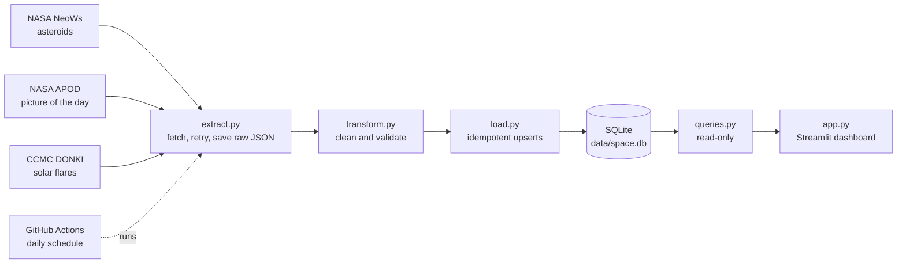

# NASA Space Dashboard

An automated data pipeline and interactive dashboard that tracks near-Earth asteroids, solar flares, and the Astronomy Picture of the Day using NASA's public APIs.

Python · pandas · SQLite · Streamlit · pytest · GitHub Actions

<!-- Add a screenshot of your running dashboard here once you have one, e.g. docs/dashboard.png -->

## What it does

- Fetches three live data sources once a day, cleans them into tidy tables, and stores them in SQLite.
- Shows them in a Streamlit dashboard, "Clayton's Astronomical Dashboard": the picture of the day first, a short always-visible guide, key numbers, and color-coded tabs for asteroids and solar flares. Filters: date presets (7, 30, 90 days, or custom) for everything, plus potentially hazardous only, closer than a distance, and minimum size for asteroids.
- Runs itself: a scheduled GitHub Actions job updates the database daily, and CI runs the tests on every push.

## Architecture



| Stage | File | Job |
|---|---|---|
| Extract | `src/extract.py` | Call each API, retry temporary failures, keep an untouched copy of every response |
| Transform | `src/transform.py` | Flatten nested JSON, convert types, parse flare classes, strip HTML, handle missing data |
| Load | `src/load.py` | Write to SQLite with upserts so reruns never create duplicates |
| Run | `src/pipeline.py` | Orchestrate the three stages and report failures |
| Backfill | `src/backfill.py` | One-time load of past data in API-sized windows (7 days for asteroids, 30 for flares) |
| Query | `src/queries.py` | Read-only queries used by the dashboard |
| Present | `app.py` | Streamlit UI; reads only from the database, never from NASA |

## Data sources

| Source | What | API key |
|---|---|---|
| NASA NeoWs | Near-Earth asteroid close approaches | Free key from api.nasa.gov |
| NASA APOD | Astronomy Picture of the Day (NASA Science endpoint) | None |
| DONKI (NASA CCMC) | Solar flare events | None |

## Setup (macOS)

Requires Python 3 and `make` (both come with Apple's command line tools).

```bash
git clone https://github.com/clayton8090/NASA_space_dashboard
cd NASA_space_dashboard
make setup      # creates .venv and installs dependencies
make key        # stores your NASA API key in the macOS Keychain (hidden prompt)
make test       # runs the test suite
make run        # fetches fresh data into data/local.db
make backfill   # optional: loads the last 90 days of history (make backfill DAYS=30 for fewer)
make dashboard  # opens the dashboard in your browser
```

Get a free NASA API key at https://api.nasa.gov. The key is read from the `NASA_API_KEY` environment variable first (used by GitHub Actions), then from your system keychain. It is never stored in the repository.

## Daily automation

`.github/workflows/daily.yml` runs every day at 06:15 UTC (and on demand from the Actions tab). It runs the tests, runs the pipeline, and commits the updated `data/space.db`.

One-time setup: add your NASA key as a repository secret named `NASA_API_KEY` (Settings, Secrets and variables, Actions).

To load history into the shared database, start the job by hand from the Actions tab and enter a number of days in the "backfill days" box.

`.github/workflows/ci.yml` runs the test suite on every push and pull request.

## Design decisions and trade-offs

- **Extract, transform, and load are separate modules.** Each can be tested, explained, and changed on its own, and cleaning logic can change without re-calling the APIs.
- **Raw responses are saved before cleaning.** If a transform has a bug, the data can be reprocessed without spending API requests.
- **Loads are idempotent.** Upserts on primary keys mean the daily job can re-fetch overlapping days and a rerun never creates duplicates.
- **The dashboard never calls NASA.** It reads a database through a read-only connection, so page views cost no API quota and cannot modify data.
- **Sources fail independently.** If one API is down, the other two still load. The job fails loudly only if every source fails.
- **Retries are limited to temporary errors.** Rate limits (429) and server errors (5xx) are retried with growing waits; client errors are not, because retrying a bad request cannot help.
- **Non-JSON responses raise a clear error.** During development NASA moved two endpoints, and one began returning a web page instead of data. The extractor now names the URL and content type instead of failing with a parse error.
- **Secrets stay out of the repo.** Keychain locally, an encrypted GitHub secret in CI, and the key is sent in a request header so it does not appear in logged URLs.
- **History is backfilled in API-sized windows.** NeoWs allows at most 7 days per request, so the backfill walks back in 7-day steps (30-day steps for flares), pauses between requests, and keeps going if one window fails. Because loads are upserts, rerunning it fills gaps without duplicates.
- **SQLite instead of a database server.** The data is small and single-writer, so a file is simpler to run and to deploy.
- **The database is committed by the daily job on purpose.** This keeps history and gives a hosted dashboard something to read without extra infrastructure. The cost is a small daily commit. Your own runs write to `data/local.db`, which git ignores, so local work never conflicts with the job.

## Testing

```bash
make test
```

Tests use small fake API responses and in-memory databases, so they run in seconds with no network access or API quota. They cover the transforms (including edge cases like missing values), loading and rerun safety, the dashboard queries, extraction behavior, and the dashboard itself via Streamlit's test harness.

## Limitations

- Only solar flares are pulled from DONKI; other event types (CMEs, geomagnetic storms) are not included.
- NASA's endpoints changed during development and may change again. Endpoint URLs are constants at the top of `src/extract.py`.

## Data credit

Asteroid and picture-of-the-day data: NASA Open APIs. Space weather data: DONKI, courtesy of the NASA Community Coordinated Modeling Center (CCMC). Picture-of-the-day images may carry their own copyright, and the dashboard shows the credit supplied with each one. This project is not endorsed by NASA.
