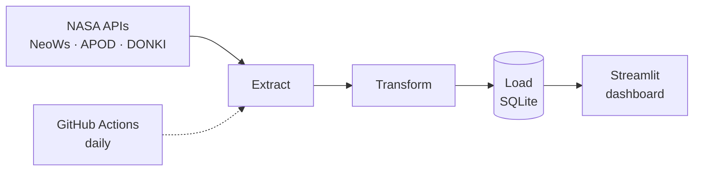

# Clayton's Astronomical Dashboard

**Live:** https://claytons-astronomical-dashboard.streamlit.app (if it has been idle, it takes a few seconds to wake up)

A self-updating dashboard of NASA data: the Astronomy Picture of the Day, near-Earth asteroid passes, and solar flares. A daily pipeline collects the data, and the dashboard explains it in plain language.

**Built with** Python · pandas · SQLite · Streamlit · Altair · pytest · GitHub Actions

## How it works



- **Extract** (`src/extract.py`) calls the APIs, retries temporary failures, and saves raw responses.
- **Transform** (`src/transform.py`) flattens nested JSON, converts types, and strips HTML.
- **Load** (`src/load.py`) upserts into SQLite, so reruns never duplicate data.
- **Dashboard** (`app.py`) reads only from the database, never from NASA.

## Run it locally (macOS)

```bash
make setup      # create .venv and install dependencies
make key        # store your free api.nasa.gov key in the Keychain
make backfill   # load the last 90 days
make dashboard  # open it in your browser
```

`make test` runs the test suite using fake data, with no network access.

## Automation

A GitHub Actions job runs the tests and the pipeline every day at 06:15 UTC, then commits the updated `data/space.db`. It needs a repository secret named `NASA_API_KEY`. CI runs the tests on every push. The live site redeploys from GitHub, so each daily update appears there automatically.

## Design choices

- Each stage is its own module, so it can be tested and changed on its own.
- Loads are idempotent: rerunning the pipeline or the backfill never creates duplicates.
- Sources fail independently, and only rate limits and server errors are retried.
- Secrets stay out of the repo: Keychain locally, an encrypted secret in CI.
- Text and links from outside sources are escaped before they're displayed.

## Data credit

NASA Open APIs (NeoWs, APOD). Space weather from DONKI, courtesy of the NASA Community Coordinated Modeling Center (CCMC). Pictures may carry their own copyright, and the dashboard shows each credit. Not endorsed by NASA.
